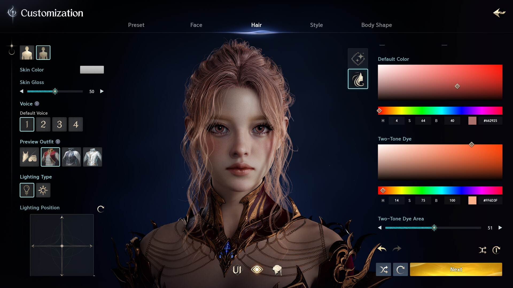
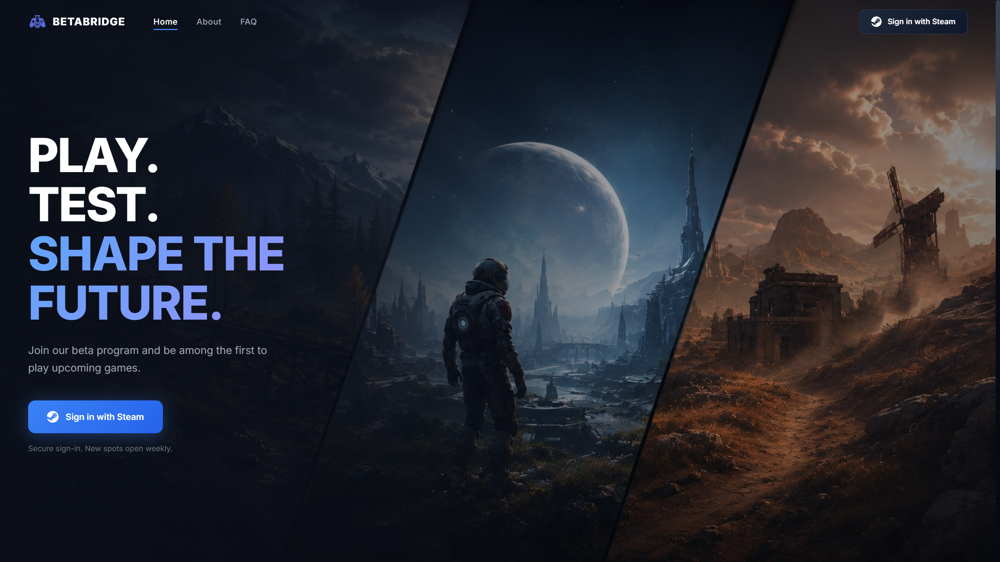

# AION 2 Beta 2026 — Game Enhancer for Windows

   

---

AION-2-Beta-2026 drops you straight into NCSOFT's next-generation MMORPG before the rest of the world gets a look, and it rewards you for being early. Test the beta, break what needs breaking, and send feedback that actually reaches the developers shaping Atreia's future. Finish the test and a free game key is yours when the title officially launches — no points, no hoops, no nonsense. This is your shot to play first, sound off, and lock in your copy.

## Features

- 🌌 **A Vast New Atreia** — Explore a world built for open-ended discovery across land, sky, and underwater regions.
- ⚔️ **Faction Warfare** — Pick your side, Elyos or Asmodian, and dive into large-scale Realm-versus-Realm conflict.
- 🪽 **Three-Dimensional Movement** — Free aerial traversal lets you travel, explore, and fight across every layer of the world.
- 🎯 **Skill-Based Combat** — Manual combat controls, real hit confirmation, and zero auto-combat. Your inputs decide the outcome.
- 🛡️ **Eight Playable Classes** — Roll as a Gladiator, Templar, Assassin, Marksman, Sorcerer, Spiritmaster, Cleric, or Chanter.
- 🏰 **Expansive Dungeon Content** — Solo, four-player, and eight-player dungeons, including a reimagined Fire Temple.
- 🎨 **Deep Character Creation** — Customize your Daeva with more than 200 adjustable character features.
- 🧭 **Community-Driven Development** — Play early, report issues, and push feedback straight to the dev team before launch.
- 🔑 **Free Game Key** — Complete the beta and lock in a free key for the full game at release.

## How It Works

The pipeline is straightforward: AION-2-Beta-2026 acts as the entry point for the AION 2 beta test, connecting you to the official beta program where testers are approved, builds go out, and feedback flows back to the development team.

**Step 1 — Sign in with Steam.** Authentication runs through Steam's official sign-in. Your credentials stay with Steam; the program only receives your profile authorization, never your password.

**Step 2 — Get approved.** Your tester profile is reviewed after sign-in. Approvals roll out as spots open up, roughly on a weekly cadence, so access isn't instant — it's earned.

**Step 3 — Request access.** Once approved, the beta test becomes visible and requestable. Claim your spot and you're in the pipeline.

**Step 4 — Play the beta build.** Download the AION 2 beta client, jump into Atreia, and put the current build through its paces — combat, traversal, dungeons, the works.

**Step 5 — Send feedback.** Report bugs, flag balance issues, and share honest impressions. This is the whole point: beta testers shape what ships.

**Step 6 — Collect your key.** When AION 2 officially launches, a free game key lands in the email tied to your account. Complete the beta, get the full game — that's the deal.

**The reward is the game itself.** No points, no currency, no hoops. Test AION 2, earn a free copy at release. Every tester who finishes the beta gets the same payout: the real game, on the house.

## Supported Platforms

**Windows PC is the home turf.** AION-2-Beta-2026 is built for 64-bit Windows 10 and 11, with DirectX 12 as the baseline — no legacy API fallbacks, no compatibility-mode guesswork.

**Minimum spec:** Intel Core i5-8400 or AMD Ryzen 5 2600, 16 GB RAM, NVIDIA GeForce GTX 1660 or AMD Radeon RX 5600 XT, 100 GB of storage, and a broadband connection. That gets you in the door and playable.

**Recommended spec:** Intel Core i7-10700 or AMD Ryzen 7 3700X, 32 GB RAM, NVIDIA GeForce RTX 3070 or AMD Radeon RX 6800, and that same 100 GB on an SSD. This is where the beta actually breathes — faster loads, steadier frames in large-scale faction fights.

**Storage matters.** 100 GB is the floor, not a suggestion. Put it on an SSD if you can; the difference in load times and streaming is night and day.

**No console ports, no mobile builds, no Mac client.** The beta is Windows-only, full stop. Controller support and other platform expansions are not part of this test cycle.

**Network:** broadband internet is required for the beta — this is an online MMORPG, not an offline preview. Expect live patching and server-side updates throughout the test window.

**Bottom line:** if you're on a modern 64-bit Windows rig with a discrete GPU and an SSD, you're cleared for takeoff.

## 📸 Screenshot

## Configuration

Tuning AION 2 for your rig is straightforward — no config archaeology required. The beta build ships with sensible defaults on Windows, and everything below is optional fine-tuning for players who want to squeeze out extra frames or dial in their setup.

### Graphics Presets

Start with the in-game preset that matches your hardware, then tweak from there:

- **Low** — For minimum-spec machines. Prioritizes stable frame rates during large-scale Realm-versus-Realm fights.
- **Medium** — The balanced default. Solid performance across open-world traversal and dungeon content.
- **High** — For recommended-spec builds. Unlocks higher texture resolution and denser draw distance.
- **Ultra** — For top-tier GPUs. Maximum visual fidelity with full effects enabled.

Drop a preset down if you notice frame drops during eight-player dungeons or faction warfare — those are the heaviest load points in the beta.

### Key Bindings

AION 2's combat is manual and skill-based, so your layout matters. The beta supports full rebinding for movement, aerial traversal, and all eight class skill sets. Set your aerial movement keys early — you'll use them constantly for travel and combat repositioning. Bind your class abilities to comfortable reaches and keep dodge/evade accessible; you'll need it in PvP.

### Display and Performance

- **Resolution and refresh rate** — Set these to match your monitor. The beta respects your native desktop resolution by default.
- **DirectX 12** — Required for both minimum and recommended specs. Make sure your GPU drivers are current before you launch.
- **Storage** — Install on an SSD if you have one. The recommended spec calls for it, and load times into dungeons improve noticeably.
- **RAM** — 16 GB is the floor; 32 GB keeps large-scale battles smooth.

### Network Settings

AION 2 is online-only, and the beta leans on a stable broadband connection — especially for Realm-versus-Realm conflict. Wired connections are strongly recommended over Wi-Fi for PvP sessions. If you hit latency spikes during faction warfare, check your connection before blaming the build.

### Character and Class Setup

Your configuration starts at character creation. With more than 200 adjustable features, build the Daeva you actually want to play. Pick from the eight classes — Gladiator, Templar, Assassin, Marksman, Sorcerer, Spiritmaster, Cleric, or Chanter — and note that class choice shapes your entire control layout and combat rhythm. Try a few in the beta; that's what it's for.

### Reporting Configuration Issues

If a setting misbehaves — a binding that won't stick, a preset that tanks performance, a display mode that won't apply — flag it through the beta feedback channel. Community-driven refinement is the whole point of this test, and your config reports help the team lock things down before launch.

## FAQ

**Q: What exactly is AION-2-Beta-2026?**
**A:** It's the beta testing program for AION 2, NCSOFT's next-generation MMORPG. Join the test, get early access to the build, and lock in a free game key when the full game launches.

**Q: What's the catch — do I pay anything?**
**A:** No catch. Beta access is free. All that's asked of you is time and real feedback. The free key is your reward for showing up and testing.

**Q: Is my Steam account safe?**
**A:** Yes. Sign-in uses Steam's official authorization — your password is never seen or stored. Your account stays entirely under your control.

**Q: How does the free key actually work?**
**A:** Complete the beta, and your key lands via email once AION 2 officially releases. No points, no grind, no gimmicks — the reward is the game itself.

**Q: When do I get into the beta?**
**A:** After signing in, your tester profile goes through approval. Approvals roll out as spots free up — roughly once a week. Once you're approved, beta tests become visible and requestable.

**Q: What do I actually do as a tester?**
**A:** Download the beta build, play the game, and report what you find — bugs, balance issues, rough edges. Honest feedback is the whole point; it shapes the game before launch.

**Q: What platforms does the beta run on?**
**A:** Windows PC. Check the system requirements above before requesting access — you'll want to meet at least the minimum spec to get a playable experience.

**Q: Will I get access the moment I sign in?**
**A:** Not instantly — approval comes first. Spots open up on a rolling basis, so if you don't get in on day one, you're still in the queue. Patience pays off here.

**Q: What happens to my feedback?**
**A:** It goes to the development team and feeds directly into refining AION 2 before launch. You're not shouting into a void — you're helping build the game.

## Disclaimer

Read this before you commit. AION-2-Beta-2026 is an unofficial community beta-access project. It is not affiliated with, endorsed by, or sponsored by NCSOFT, and "AION" and all related marks, artwork, and game content belong to their respective owners.

Beta keys, tester approvals, and access windows are limited and allocated at the discretion of the beta program — nothing here guarantees a spot. Availability of the beta itself, its content, and its timelines can change or be discontinued at any time, and the free game key is tied to the official release of the game, not to this project. Details like system requirements, features, and class rosters reflect pre-release information and may shift before launch.

Everything is provided as-is, with no warranty of any kind. You install and run beta builds at your own risk; back up your data and use a dedicated test environment. The authors accept no liability for account issues, data loss, hardware strain, or any other damages arising from use of this project or the beta software it points to. Play fair, report bugs honestly, and don't redistribute beta builds, keys, or client files.

